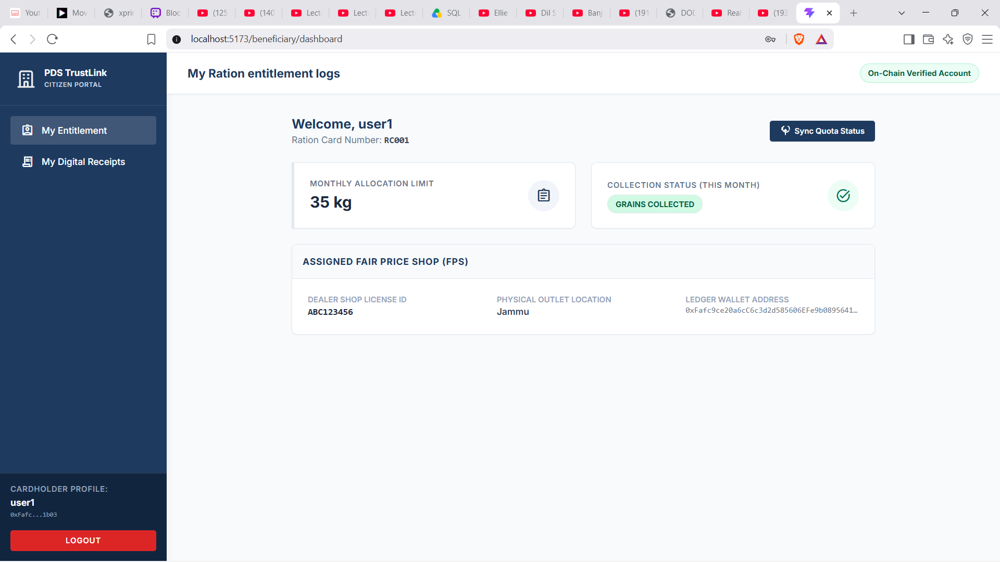
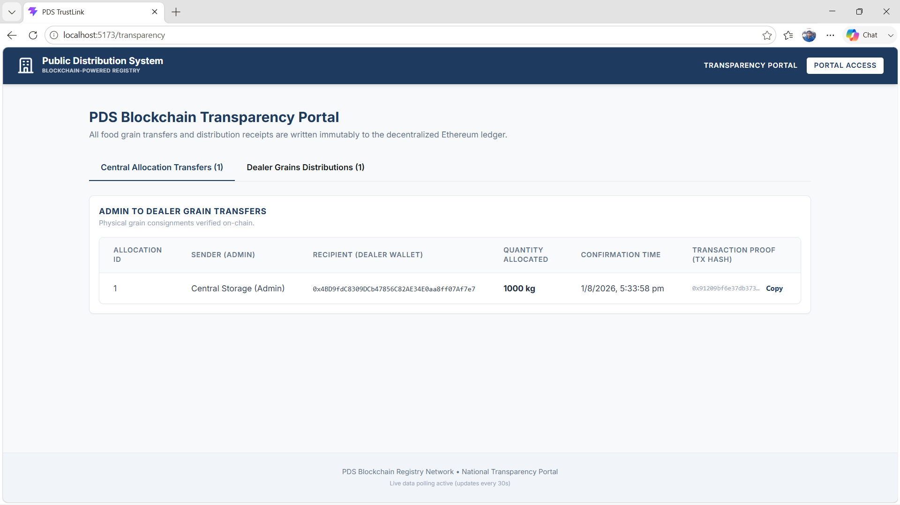
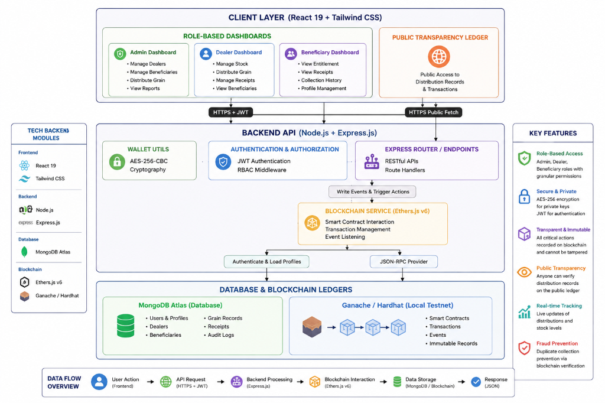

# 🏛️ PDS TrustLink: Blockchain-Powered Public Distribution System

[](https://soliditylang.org/)
[](https://react.dev/)
[](https://nodejs.org/)
[](https://www.mongodb.com/)
[](https://hardhat.org/)

**PDS TrustLink** is a next-generation, decentralized, and tamper-proof Ration Management & Public Distribution System (PDS). By leveraging Ethereum-based smart contracts, a robust Node.js backend, and a modern React frontend, it completely eliminates leakages, prevents double-collection, and introduces absolute transparency to essential grain distribution.

---

## 📌 Project Overview & Purpose

The traditional Public Distribution System often suffers from lack of transparency, black marketing, leakage of food grains, and duplicate/ghost card issues. 

**PDS TrustLink** solves these systemic problems by putting critical state changes on an immutable blockchain ledger:
1. **Zero Leakage:** Every grain transfer from central stores to Fair Price Shop (FPS) dealers is signed and recorded on-chain.
2. **No Double-Collection:** Smart contract logic cryptographically blocks multiple ration claims within a single month.
3. **Public Auditing:** Citizens, NGOs, and auditors can track allocations and claims in real-time via the public **Transparency Portal** without needing to log in.
4. **Verifiable Digital Receipts:** Every distribution generates a cryptographically signed receipt containing the exact distribution details and a blockchain transaction reference.

---

## 📸 User Interface Gallery

> [!TIP]
> To display screenshots on your GitHub repository, create a `screenshots` folder in the root directory, save your screenshots as PNG files, and commit them.

| Admin Dashboard | Dealer Panel |
| :---: | :---: |
|  |  |

| Beneficiary (User) Panel | Transparency Portal |
| :---: | :---: |
|  |  |

---

## ⚙️ Technical Architecture

This system uses a **Hybrid Architecture** designed for speed, scalability, and cryptographic security:



---

## 🚀 Key Features

* **🔑 Role-Based Access Control (RBAC):** Dedicated, secure dashboards for:
  * **Admin:** Register dealers/beneficiaries, assign monthly quotas, and issue bulk grain transfers.
  * **FPS Dealer:** Receive grain stocks, verify beneficiary allocations, distribute ration, and issue blockchain receipts.
  * **Beneficiary:** Track monthly entitlements, view transaction history, and access digital receipts.
* **🛡️ Preventative Smart Contracts:** The `BeneficiaryManagement` contract enforces a strict state machine preventing double claims.
* **📊 Public Transparency Ledger:** An unauthenticated page that pulls transaction logs directly from the blockchain node, allowing anyone to verify system honesty.
* **💼 Local Wallet Management:** Secure storage of wallet details linked to backend roles for seamless smart contract interaction.
* **🔄 Fast Demo Reset & Validation:** A public "Reset Demo Data" button on the home page and login card that wipes transient MongoDB data, checks contract deployment bytecode integrity on-chain, and seeds a default Admin and initial Warehouse Stock, enabling quick repeated local demonstrations.

---

## 🛠️ Technology Stack

| Layer | Technology | Purpose |
| :--- | :--- | :--- |
| **Frontend** | React 19 (Vite), Tailwind CSS, React Router DOM, Axios | Fast, modern, responsive UI with deep navy/slate government styling. |
| **Backend** | Node.js, Express.js, MongoDB (Mongoose) | Fast API processing, user authentication (JWT), and off-chain data indexing. |
| **Blockchain** | Solidity (v0.8.24), Hardhat, Ganache, Ethers.js (v6) | Decentralized ledger, smart contract testing, deployment, and programmatic RPC interaction. |

---

## 📂 Project Directory Structure

```text
├── Backend/              # Node.js Express server and MongoDB connection
│   ├── config/           # Database configuration
│   ├── controllers/      # Route controllers (Admin, Dealer, Beneficiary)
│   ├── middleware/       # JWT authentication and authorization
│   ├── models/           # Mongoose schemas (User, Dealer, Beneficiary)
│   ├── routes/           # API Endpoint routes
│   ├── services/         # Ethers.js blockchain wrapper functions
│   └── server.js         # Entry point for backend Express app
│
├── Blockchain/           # Hardhat Ethereum smart contract suite
│   ├── contracts/        # Solidity smart contracts
│   ├── scripts/          # Deploy and execution scripts
│   ├── test/             # Contract unit tests
│   └── hardhat.config.js # Hardhat development parameters
│
└── Frontend/             # React Vite client-side application
    ├── public/           # Static assets & icons
    ├── src/
    │   ├── components/   # Reusable UI elements (Navbar, Cards, Loaders)
    │   ├── context/      # Global Authentication state
    │   ├── pages/        # Main pages (Landing, Login, Dashboard, Portal)
    │   └── services/     # Axios API integrations
```

---

## 💻 Local Setup & Installation

Follow these steps to run the complete PDS project on your local machine:

### 📋 Prerequisites
* [Node.js](https://nodejs.org/) (v18.x or v20.x recommended)
* [MongoDB](https://www.mongodb.com/try/download/community) (running locally or a MongoDB Atlas cloud URI)
* [Ganache](https://trufflesuite.com/ganache/) or Hardhat Local Node (for local blockchain testing)

---

### Step 1: Clone the Repository & Configure Blockchain
1. Navigate to the `Blockchain` directory and install dependencies:
   ```bash
   cd Blockchain
   npm install
   ```
2. Start your local blockchain testnet (Ganache or Hardhat node):
   ```bash
   # Run local hardhat network node
   npx hardhat node
   ```
3. Compile and deploy the smart contracts to the local network:
   ```bash
   npx hardhat run scripts/deploy.js --network localhost
   ```
   > [!IMPORTANT]
   > Copy the three deployed contract addresses (`GrainTransfer`, `BeneficiaryManagement`, and `ReceiptManager`) from the console output. You will need them for the Backend configuration.

---

### Step 2: Configure & Launch Backend
1. Navigate to the `Backend` directory:
   ```bash
   cd ../Backend
   npm install
   ```
2. Create a `.env` file in the `Backend` directory:
   ```env
   PORT=5000
   MONGO_URI=mongodb://127.0.0.1:27017/pds-blockchain
   JWT_SECRET=your_jwt_secret_key_here
   GANACHE_RPC_URL=http://127.0.0.1:8545

   # Add deployed addresses here
   GRAIN_TRANSFER_ADDRESS=0x...
   BENEFICIARY_MGMT_ADDRESS=0x...
   RECEIPT_MANAGER_ADDRESS=0x...

   # Admin's private key (Use first key from local Ganache/Hardhat node)
   ADMIN_PRIVATE_KEY=0x...

   # Initial Central Warehouse Stock (in kg)
   INITIAL_WAREHOUSE_STOCK=100000
   ```
3. Seed the database with mock roles and users:
   ```bash
   npm run seed
   ```
4. Start the backend server:
   ```bash
   # Production mode
   npm start
   
   # Development mode (with nodemon auto-restart)
   npm run dev
   ```

---

### Step 3: Configure & Launch Frontend
1. Navigate to the `Frontend` directory:
   ```bash
   cd ../Frontend
   npm install
   ```
2. Create a `.env` file in the `Frontend` directory:
   ```env
   VITE_API_URL=http://localhost:5000
   ```
3. Start the development server:
   ```bash
   npm run dev
   ```
4. Open [http://localhost:5173](http://localhost:5173) in your browser to view the application.

---

## 📜 Smart Contracts Description

1. **`BeneficiaryManagement.sol`:** Holds registered beneficiary wallets, handles monthly entitlement quotas, marks monthly claim status, and manages monthly resets.
2. **`GrainTransfer.sol`:** Logs grain transport volumes from government central buffer storage to localized FPS shops.
3. **`ReceiptManager.sol`:** Generates digital receipt blocks with off-chain reference hashes for public transparency and validation.

---

## 🤝 final Year Project Team Credits
* **Developer/Author:** Aditya Yadav
* **University/College:** Nitte Meenakshi Institute of Technology
* **Contribution:** Core System Architecture, Solidity Contracts, Node.js API, React Frontend implementation.

---

## 📄 License
This project is licensed under the ISC License. Feel free to use and adapt this code for educational and project purposes. Please provide appropriate credits to the original repository.
