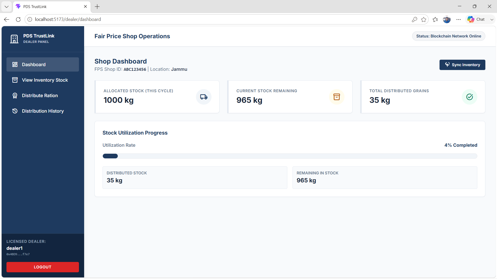

# 🏛️ PDS TrustLink: Blockchain-Powered Public Distribution System

[](https://soliditylang.org/)
[](https://react.dev/)
[](https://nodejs.org/)
[](https://www.mongodb.com/)
[](https://hardhat.org/)

**PDS TrustLink** is a next-generation, decentralized, and tamper-proof Ration Management & Public Distribution System (PDS). By leveraging Ethereum-based smart contracts, a robust Node.js backend, and a modern React frontend, it completely eliminates leakages, prevents double-collection, and introduces absolute transparency to essential food grain distribution with OTP registration security and downloadable PDF receipts with embedded cryptographic QR verification.

---

## 📌 Project Overview & Purpose

The traditional Public Distribution System often suffers from lack of transparency, black marketing, physical grain leakages, and duplicate/ghost ration card issues. 

**PDS TrustLink** solves these systemic problems by putting critical state changes on an immutable blockchain ledger with robust cryptographic checks:

1. **Zero Leakage:** Every grain transfer from central stores to Fair Price Shop (FPS) dealers is cryptographically signed and logged on-chain.
2. **OTP-Verified Citizen Onboarding:** Prevents unauthorized or fraudulent cardholder registrations using a secure, local 6-digit OTP verification protocol.
3. **No Double-Collection:** Smart contract state machines in `BeneficiaryManagement.sol` cryptographically block multiple ration claims within a single calendar month.
4. **Verifiable Official PDF Receipts:** Every ration distribution automatically generates a downloadable, Government-styled PDF receipt embedded with a dynamic verification QR code.
5. **Public QR Receipt Verification:** Anyone can scan a printed or digital receipt QR code to verify its authenticity directly against the Ethereum blockchain without needing to log in.
6. **Public Auditing Ledger:** Citizens, NGOs, and auditors can track allocations and claims in real-time via the public **Transparency Portal**.

---

## 📸 User Interface Gallery

> [!TIP]
> To display screenshots on your GitHub repository, create a `screenshots` folder in the root directory, save your screenshots as PNG files, and commit them.

| Admin Dashboard | Dealer Panel |
| :---: | :---: |
|  |  |

| Beneficiary (User) Panel | Transparency Portal |
| :---: | :---: |
|  |  |

---

## ⚙️ Technical Architecture

This system uses a **Hybrid Architecture** designed for speed, off-chain privacy, and decentralized on-chain cryptographic security:


```text
               ┌────────────────────────────────────────────────────────┐
               │                  React 19 Client UI                    │
               │  (Admin, Dealer, Beneficiary Dashboards & Verification)│
               └───────────┬────────────────────────────────┬───────────┘
                           │                                │
                 REST APIs │                     QR Scans / │ Public Verification
                           ▼                                ▼
               ┌───────────────────────┐        ┌───────────────────────┐
               │    Node.js Express    │        │  Public Verification  │
               │    Backend Engine     │◄───────┤     API Controller    │
               └───────────┬───────────┘        └───────────┬───────────┘
                           │                                │
            ┌──────────────┴──────────────┐                 │
            ▼                             ▼                 │
 ┌─────────────────────┐       ┌──────────────────────┐     │
 │   MongoDB Database  │       │ Ethereum RPC Node    │◄────┘
 │ (Off-chain metadata,│       │ (Ganache / Hardhat)  │
 │  OTP sessions, PII) │       │ (Smart Contracts)    │
 └─────────────────────┘       └──────────────────────┘
```

---

## 🚀 Key Features

### 1. 🔐 OTP-Based Beneficiary Registration Verification
* **Cryptographic OTP Generation:** Generates a secure, 6-digit numeric OTP using Node.js `crypto` (no external paid SMS gateway required for local testing).
* **Console-Delivered OTP:** Displays formatted OTPs directly inside the backend terminal for safe, cost-free academic and viva demonstration.
* **Brute-Force & Replay Protection:** Enforces a 5-minute expiry timer and max 3 incorrect attempts before automatically locking the session.
* **Cryptographic Token Authorization:** Upon successful verification, issues a single-use SHA-256 hashed verification token that the backend strictly requires before creating any cardholder in MongoDB or on-chain.
* **Automatic Invalidation:** Modifying form inputs after verification immediately revokes the session to prevent identity-swapping attacks.

### 2. 📄 Official PDF Receipts with Verification QR Code
* **High-Fidelity PDF Generation:** Automatically generates an official Government-styled PDF receipt for every successful distribution using `PDFKit`.
* **Embedded QR Code:** Embeds a high-contrast PNG QR code pointing directly to the receipt's public verification URL.
* **Tamper-Evident Ledger Proof:** Displays the cardholder details, issuing Fair Price Shop, commodity weight, mined block number, and the exact Ethereum transaction hash.
* **Role-Based Download Access:** Dealers can download receipts for distributions performed at their shop; beneficiaries can access their complete historical ledger from the **My Receipts** tab.

### 3. 🔍 Public QR Receipt Verification Portal (`/verify/:receiptId`)
* **Zero Authentication Required:** Citizens and auditors can verify any receipt by scanning the QR code or visiting the URL without logging in.
* **Live Smart Contract Cross-Examination:** The backend does not merely check the database; it queries `ReceiptManager.sol` on the Ethereum blockchain and validates:
  * Blockchain Receipt ID
  * Distributed Commodity Quantity
  * Transaction Reference Hash
  * Beneficiary ID mapping
  * Timestamp consistency
* **Citizen Privacy Protection (PII Masking):** Beneficiary names (`Ad**** Ku***`) and Ration Card numbers (`RC***1`) are masked. Beneficiary phone numbers and private keys are **never** exposed.
* **Integrity Discrepancy Detection:** If quantities, hashes, or receipt IDs are altered, the portal displays a prominent red warning banner detailing the exact discrepancy.
* **Sliding-Window Rate Limiting:** In-memory request limiter prevents automated brute-force querying (>30 requests/minute per IP).

### 4. 📊 Public Blockchain Transparency Ledger
* **Live Event Polling:** Directly queries on-chain events (`GrainTransferred` from `GrainTransfer.sol` and `RationCollected` from `BeneficiaryManagement.sol`).
* **Audit Categories:** Separated into **Central Allocation Transfers** (Government Central Warehouse &rarr; FPS Dealer) and **Dealer Grains Distributions** (FPS Dealer &rarr; Beneficiary).

---

## 🛠️ Technology Stack

| Layer | Technology | Purpose |
| :--- | :--- | :--- |
| **Frontend** | React 19 (Vite), Tailwind CSS, React Router DOM, Axios | Fast, modern, responsive UI with deep navy/slate government styling. |
| **Backend** | Node.js, Express.js, MongoDB (Mongoose), JWT, Bcrypt | REST API processing, role-based authorization, rate limiting, and off-chain data indexing. |
| **PDF & QR Engine** | PDFKit, QRCode | Programmatic vector PDF generation and embedded dynamic verification QR codes. |
| **Security & OTP** | Node.js `crypto` | Cryptographically secure pseudo-random number generation (CSPRNG) and SHA-256 token hashing. |
| **Blockchain** | Solidity (v0.8.24), Hardhat, Ganache, Ethers.js (v6) | Decentralized ledger, smart contract state machines, and programmatic JSON-RPC interaction. |

---

## 📂 Project Directory Structure

```text
├── Backend/                      # Node.js Express server & MongoDB connection
│   ├── config/                   # Database connection configuration
│   ├── controllers/              # Route controllers (Admin, Dealer, Beneficiary, Dashboard)
│   │   ├── adminController.js    # Beneficiary/dealer registration & OTP APIs
│   │   ├── authController.js     # User authentication and JWT management
│   │   ├── beneficiaryController.js # Citizen profile, receipts history & PDF downloads
│   │   ├── dashboardController.js   # Public receipt verification & PII masking
│   │   └── dealerController.js   # Distribution execution & receipt generation
│   ├── middleware/               # JWT authentication & role-based authorization
│   ├── models/                   # Mongoose schemas
│   │   ├── Beneficiary.model.js  # Cardholder records with validated mobile numbers
│   │   ├── Dealer.model.js       # Fair Price Shop inventory profiles
│   │   ├── OtpSession.model.js   # Cryptographic OTP sessions with TTL auto-expiry
│   │   ├── Receipt.model.js      # Off-chain receipt metadata & blockchain proof mapping
│   │   └── User.model.js         # User credentials, roles & encrypted wallet keys
│   ├── routes/                   # Express API endpoint routes
│   ├── scripts/                  # Automated verification & regression test suites
│   │   ├── test-otp-phase1.js    # 30-assertion OTP engine test suite
│   │   ├── test-phase3-security.js # 28-assertion registration security suite
│   │   ├── test-phase4-pdf.js    # 26-assertion PDF generation & auth suite
│   │   ├── test-phase5-integration.js # 17-assertion dashboard integration suite
│   │   └── test-phase6-verification.js# 35-assertion public QR verification suite
│   ├── services/                 # Business logic & blockchain wrappers
│   │   ├── blockchainService.js  # Ethers.js v6 smart contract bindings
│   │   └── pdfService.js         # High-fidelity PDFKit receipt generation
│   ├── .env                      # Backend environment configurations
│   └── server.js                 # Entry point for backend Express app
│
├── Blockchain/                   # Hardhat Ethereum smart contract suite
│   ├── contracts/                # Solidity smart contracts
│   │   ├── BeneficiaryManagement.sol # Quotas, claim status & double-collection prevention
│   │   ├── GrainTransfer.sol     # Central buffer to FPS shop allocation tracking
│   │   └── ReceiptManager.sol    # Immutable digital receipt blocks & verification logs
│   ├── scripts/                  # Deployment & execution scripts
│   ├── test/                     # Contract unit tests
│   └── hardhat.config.js         # Hardhat development parameters
│
└── Frontend/                     # React Vite client-side application
    ├── src/
    │   ├── components/           # Reusable UI elements (Navbar, Cards, Loaders, DataTables)
    │   ├── context/              # Global Authentication state
    │   ├── pages/                # Application pages
    │   │   ├── admin/            # Admin layouts, quota allocation, grain transfer
    │   │   │   └── RegisterBeneficiary.jsx # OTP generation, verification & registration UI
    │   │   ├── beneficiary/      # Beneficiary dashboards & My Receipts table
    │   │   ├── dealer/           # Dealer dashboards & Distribute Ration page
    │   │   ├── LandingPage.jsx   # Public landing portal
    │   │   ├── TransparencyDashboard.jsx # Public blockchain transparency ledger
    │   │   └── VerifyReceipt.jsx # Public QR code verification page
    │   └── services/             # Axios API client & request interceptors
    └── .env                      # Frontend environment configurations
```

---

## 💻 Local Setup & Installation

### 📋 Prerequisites
* [Node.js](https://nodejs.org/) (v18.x, v20.x, or v24.x)
* [MongoDB](https://www.mongodb.com/try/download/community) (running locally on port `27017` or MongoDB Atlas URI)
* [Ganache](https://trufflesuite.com/ganache/) (GUI on port `7545` or CLI on `8545`)

---

### Step 1: Clone Repository & Deploy Smart Contracts
1. Navigate to the `Blockchain` directory and install dependencies:
   ```bash
   cd Blockchain
   npm install
   ```
2. Start your local blockchain node (Ganache on port `7545` or Hardhat node):
   ```bash
   # If using Hardhat local node
   npx hardhat node
   ```
3. Compile and deploy the smart contracts:
   ```bash
   npx hardhat run scripts/deploy.js --network localhost
   ```
   > [!IMPORTANT]
   > Copy the three deployed contract addresses (`GrainTransfer`, `BeneficiaryManagement`, and `ReceiptManager`) and the Admin private key from your console output.

---

### Step 2: Configure & Launch Backend
1. Navigate to the `Backend` directory:
   ```bash
   cd ../Backend
   npm install
   ```
2. Create or update `.env` in the `Backend` directory:
   ```env
   PORT=5000
   MONGO_URI=mongodb://127.0.0.1:27017/pds-blockchain
   JWT_SECRET=pds_blockchain_super_secret_jwt_key_2026_final_year_project
   GANACHE_RPC_URL=http://127.0.0.1:7545

   # Deployed Contract Addresses
   GRAIN_TRANSFER_ADDRESS=0x...
   BENEFICIARY_MGMT_ADDRESS=0x...
   RECEIPT_MANAGER_ADDRESS=0x...

   # Admin Private Key (Account 0 from Ganache)
   ADMIN_PRIVATE_KEY=0x...

   # Frontend URL for QR Code Verification (localhost or LAN IP)
   FRONTEND_URL=http://localhost:5173
   ```
3. Seed the database with mock roles and initial inventory:
   ```bash
   npm run seed
   ```
4. Start the backend server:
   ```bash
   npm run dev
   ```

---

### Step 3: Configure & Launch Frontend
1. Navigate to the `Frontend` directory:
   ```bash
   cd ../Frontend
   npm install
   ```
2. Create `.env` in the `Frontend` directory:
   ```env
   VITE_API_URL=http://localhost:5000
   ```
3. Start the Vite development server:
   ```bash
   npm run dev
   ```
4. Open [http://localhost:5173](http://localhost:5173) in your browser.

---

## 🧪 Automated Testing & Verification Suite

The repository contains an exhaustive automated test suite covering all functional modules with **136 automated assertions passing at 100%**:

```bash
cd Backend

# Run all test suites in sequence
node scripts/test-otp-phase1.js           # 30 tests: OTP generation, expiry, rate limits
node scripts/test-phase3-security.js      # 28 tests: Token security & registration locks
node scripts/test-phase4-pdf.js           # 26 tests: PDF generation, QR & auth barriers
node scripts/test-phase5-integration.js   # 17 tests: Dealer/beneficiary dashboard flows
node scripts/test-phase6-verification.js  # 35 tests: Public verification, smart contract cross-check, privacy
```

---

## 🎯 Step-by-Step Demonstration Guide

Follow this sequence to demonstrate all core features during reviews or presentations:

### 1. Citizen Registration with OTP Verification
1. Log in as **Admin** (`admin@pds.com` / `Password123`).
2. Navigate to **Register Beneficiary** (`/admin/register-beneficiary`).
3. Fill in citizen name, ration card number, monthly quota, and a 10-digit mobile number.
4. Click **Generate OTP**. Notice the live 5-minute countdown timer.
5. Check the **backend terminal window** for the printed OTP banner.
6. Enter the 6-digit code in the frontend and click **Verify OTP**.
7. The **Register Beneficiary** button unlocks. Click it to register the cardholder on-chain and in MongoDB.

### 2. Grain Distribution & PDF Receipt
1. Log in as **FPS Dealer** (`dealer1@pds.com` / `Password123`).
2. Navigate to **Distribute Ration** (`/dealer/distribute`).
3. Enter the card number and quantity, then click **Distribute Ration**.
4. The transaction executes on `BeneficiaryManagement.sol` and mints on `ReceiptManager.sol`.
5. Click **Download PDF Receipt** to review the official PDF with embedded QR code.

### 3. Public QR Verification
1. Open the downloaded PDF receipt and click/scan the verification QR code (or visit `http://localhost:5173/verify/<receiptId>`).
2. Notice **no login is required**.
3. The page cross-examines the live smart contract and displays the green **"Blockchain Record Verified"** badge with masked citizen details.

### 4. Public Transparency Ledger
1. Click **Transparency Portal** from the top navbar (`/transparency`).
2. Review **Central Allocation Transfers** and **Dealer Grains Distributions** to verify public auditability.

---

## 🌐 Network Scope & QR Scanning (For Viva / Demo)

* **Single Machine Testing (`http://localhost:5173`):** Clicking the link or testing within the browser on the host computer works out-of-the-box.
* **Smartphone LAN Scanning (`http://<LAN_IP>:5173`):** To scan the printed or on-screen QR code using an external phone on the same Wi-Fi network:
  1. Find your machine's local IP (e.g. `ipconfig` &rarr; `192.168.1.15`).
  2. Set `FRONTEND_URL=http://192.168.1.15:5173` in `Backend/.env`.
  3. Ensure Windows Firewall permits incoming connections on port `5173` and `5000`.
  4. All newly downloaded receipts will immediately embed the LAN URL into the QR code.

---

## 📜 Smart Contracts Description

1. **`BeneficiaryManagement.sol`:** Holds registered beneficiary wallets, handles monthly entitlement quotas, prevents double-claims, and manages monthly resets.
2. **`GrainTransfer.sol`:** Logs grain transport volumes from government central buffer storage to localized FPS shops.
3. **`ReceiptManager.sol`:** Generates immutable digital receipt blocks linked to off-chain transaction reference hashes for public auditability.

---

## 🤝 Final Year Project Team Credits
* **Developer/Author:** Aditya Yadav
* **University/College:** Nitte Meenakshi Institute of Technology
* **Contribution:** Core System Architecture, Solidity Contracts, Node.js API, React Frontend implementation.

---

## 📄 License
This project is licensed under the ISC License. Feel free to use and adapt this code for educational and project purposes. Please provide appropriate credits to the original repository.
